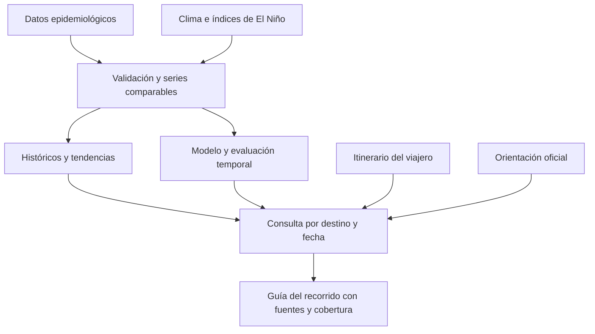

# Guía climática y sanitaria para viajeros en Sudamérica

### Destinos, fechas y datos para preparar mejor un viaje

**Itinerario · Situación epidemiológica · Clima · Tendencias · Orientación oficial**

Proyecto para la hackatón FACI. Nombre oficial por definir.

## La idea

Crear una guía inteligente que permita a los viajeros consultar información sobre enfermedades transmitidas por mosquitos, como **dengue, Zika y chikungunya**, según los destinos y las fechas de su recorrido por Sudamérica.

El viajero ingresaría su itinerario. La plataforma combinaría antecedentes epidemiológicos, temporada e información climática para mostrar la situación de cada destino y, cuando exista un modelo evaluado y datos suficientes, estimar posibles aumentos de casos a corto plazo. También reuniría orientación preventiva y avisos de fuentes oficiales.

La pregunta que queremos ayudar a responder es:

> **Para los lugares y las fechas de mi viaje, ¿qué situación sanitaria debería conocer y cómo puedo prepararme?**

**Estado actual:** se ha actualizado la definición del producto. El repositorio conserva datos, scripts y notebooks de exploración de dengue y clima en Piura. Todavía no contiene una guía ejecutable, una integración regional ni un modelo validado para viajeros. [Ver evidencia y antecedentes](docs/ANTECEDENTES.md).

## Para quién y para qué

| Aspecto | Propuesta actual |
| --- | --- |
| Usuario principal | Persona que prepara un viaje por Sudamérica |
| Entrada principal | Destinos y fechas de llegada y salida |
| Resultado esperado | Resumen por parada con situación notificada, tendencias, fuentes y orientación oficial |
| Enfermedades de interés | Dengue, Zika y chikungunya |
| Alcance regional | Visión del producto; no implica que todos los países estén integrados |
| Primer piloto | Propuesta de dos o tres países, por seleccionar según datos comparables |
| Primer modelo | Una enfermedad con cobertura suficiente; selección pendiente |
| Horizonte predictivo | Propuesta de 2–4 semanas, sujeto a validación |

Las fechas que excedan el horizonte del modelo mostrarían información histórica, estacional y avisos disponibles, sin extrapolar un pronóstico. El detalle del mapa respetaría la escala de la fuente: datos nacionales producen información nacional, no predicciones de ciudades.

## Cómo funcionaría

1. El usuario registra las paradas de su viaje y sus fechas.
2. El sistema relaciona cada parada con la unidad territorial que cubren los datos.
3. Presenta casos notificados, tendencia reciente, estacionalidad y fecha de corte.
4. Añade una estimación experimental solo cuando el destino, la enfermedad y las fechas estén cubiertos por un modelo evaluado.
5. Reúne enlaces y orientación oficial aplicables al destino y muestra la procedencia de cada resultado.

## Qué aporta la propuesta

El posible diferencial es reunir **itinerario, fechas, tendencias y orientación oficial**, mostrando cuándo una estimación es aplicable y qué información falta. Su utilidad debe contrastarse con viajeros y con las herramientas existentes.

Ya existen el [ARBO Portal de la OPS](https://www.paho.org/es/arbo-portal), los [avisos de salud para viajeros del CDC](https://wwwnc.cdc.gov/travel/notices) y servicios de alertas como [Sitata](https://www.sitata.com/en/travel-insurance-for-your-trip/). No se afirma ser la primera guía sanitaria ni haber demostrado una mejora frente a esos servicios. [Ver comparación de referencias](docs/FUENTES.md).

El vínculo con el reto **clima, agua y gestión de riesgos** se plantea mediante el análisis de condiciones climáticas y la preparación informada del viaje. Se evaluará si el clima aporta capacidad predictiva; el producto no gestiona infraestructura de agua. La admisibilidad depende de las bases del reto.

## Fuentes candidatas

| Fuente | Uso previsto | Situación en este repositorio |
| --- | --- | --- |
| [OPS: ARBO Portal](https://www.paho.org/es/arbo-portal) y [datos abiertos](https://opendata.paho.org/es) | Series de dengue, Zika y chikungunya | Fuente identificada; descarga, cobertura y comparabilidad regional pendientes |
| Autoridades sanitarias nacionales | Ampliar el detalle territorial y documentar definiciones de caso | Países y conjuntos concretos por seleccionar |
| [NASA POWER](https://power.larc.nasa.gov/docs/services/api/temporal/daily/) | Series meteorológicas históricas | Hay exploración previa para puntos de Piura; adaptación regional pendiente |
| [NOAA PSL](https://psl.noaa.gov/data/timeseries/month/) | Índices climáticos relacionados con El Niño | Hay un notebook exploratorio; disponibilidad temporal y transformación por revisar |
| [CDC: Travelers’ Health](https://wwwnc.cdc.gov/travel/notices) | Avisos y orientación oficial para viajeros | Referencia identificada; integración aún no implementada |

Las fuentes pueden revisar sus series. Cada descarga deberá guardar procedencia, versión, fecha de consulta y condiciones de uso. Una fuente identificada no equivale a un dataset integrado o validado.

## Datos y machine learning

La unidad inicial propuesta es **territorio + enfermedad + semana**, conservando la definición de caso, fuente y fecha de disponibilidad. Antes de entrenar se debe comprobar si las series de distintos países son comparables.

El primer experimento compararía una referencia sencilla con un modelo candidato y mediría por separado el aporte del clima y de los indicadores de El Niño. La selección de algoritmo depende de cobertura y evaluación temporal, no de una promesa de precisión. [Plan de evaluación](docs/EVALUACION.md).

Los resultados describirían **tendencias epidemiológicas de una zona**. No representan la probabilidad individual de que un viajero se enferme. Una ausencia de notificaciones no se interpretará automáticamente como ausencia de riesgo; se mostrará el estado de los datos. Las recomendaciones conservarían su fuente oficial y su vigencia.

## Alcance de la primera versión

- [ ] Inventariar datos y elegir países y enfermedad del primer modelo.
- [ ] Permitir registrar un itinerario con fechas.
- [ ] Consultar históricos y situación epidemiológica con fecha de corte visible.
- [ ] Incorporar un pronóstico únicamente tras evaluarlo contra una referencia.
- [ ] Mostrar orientación oficial y su procedencia.
- [ ] Resolver destinos sin datos, series desactualizadas y fechas fuera del horizonte.
- [ ] Probar con viajeros si la guía facilita preparar el recorrido.

La optimización de itinerarios según presupuesto y duración es una posible ampliación. No forma parte de una función ya implementada ni de una garantía de viaje seguro. [Alcance y criterios de aceptación](docs/ALCANCE.md).

## Equipo y tecnología

| Frente | Aporte previsto |
| --- | --- |
| Ingeniería Informática | Ingesta, calidad, modelado, aplicación e integración |
| Ingeniería Industrial | Proceso de planificación del viaje, comparación de alternativas, criterios de decisión y evaluación de utilidad |

La asignación de personas está pendiente de acuerdo del equipo. [Reparto propuesto](docs/EQUIPO.md).

Se propone **Python, pandas, scikit-learn, Streamlit y Plotly**. Son decisiones de implementación por confirmar. No hay todavía un entorno de dependencias fijado ni un comando para ejecutar la guía; los notebooks previos tienen sus propias dependencias y rutas.

## Organización del repositorio

| Ruta | Contenido |
| --- | --- |
| [`docs/`](docs/ALCANCE.md) | Definición del producto, fuentes, contratos, evaluación y roadmap |
| [`data/`](data/README.md) | Convenciones de datos y plantillas sin observaciones inventadas |
| [`notebooks/`](notebooks/README.md) | Exploración previa de dengue y clima en Piura |
| [`scripts/`](scripts/README.md) | Descargas y transformaciones exploratorias anteriores |
| [`src/`](src/README.md) | Directorios documentados para la implementación futura |
| [`app/`](app/README.md) | Especificación de la guía; sin aplicación ejecutable todavía |
| [`reports/`](reports/README.md) | Reportes existentes del piloto anterior y futura evaluación regional |
| [`models/`](models/README.md) | Convenciones para artefactos futuros; sin modelo regional validado |

Los archivos del piloto anterior se conservan para revisión y posible reutilización. Sus límites y problemas conocidos están registrados en [Antecedentes](docs/ANTECEDENTES.md); no deben presentarse como cobertura sudamericana.

## Documentación del proyecto

- [Alcance y decisiones pendientes](docs/ALCANCE.md)
- [Historias de usuario y experiencia propuesta](docs/PRODUCTO.md)
- [Fuentes y referencias existentes](docs/FUENTES.md)
- [Contratos y calidad de datos](docs/DATOS.md)
- [Arquitectura propuesta](docs/ARQUITECTURA.md)
- [Evaluación del modelo y del producto](docs/EVALUACION.md)
- [Comparación de destinos e itinerarios](docs/PRIORIZACION.md)
- [Equipo y entregables](docs/EQUIPO.md)
- [Roadmap](docs/ROADMAP.md)
- [Guion de demo](docs/DEMO.md)
- [Decisiones del proyecto](docs/DECISIONES.md)
- [Antecedentes y estado comprobable](docs/ANTECEDENTES.md)
- [Cómo colaborar](CONTRIBUTING.md)
