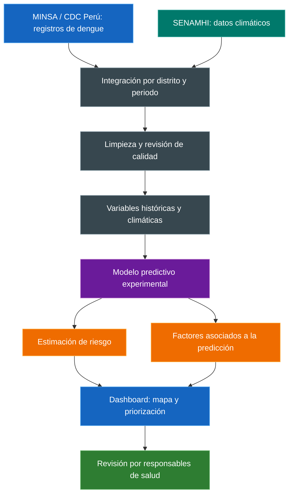

# 🦟 Predicción del riesgo de dengue en Piura

### Datos climáticos y epidemiológicos para apoyar la prevención

**HACKATHON FACI 2026 · Tecnología con impacto para el Perú**

Universidad Peruana Cayetano Heredia  
Facultad de Ciencias e Ingeniería  
Ingeniería Informática + Ingeniería Industrial

**Integrar datos · Estimar riesgo · Explicar resultados · Priorizar zonas**

> Plataforma web de alerta temprana experimental que busca integrar información climática y epidemiológica para estimar el riesgo de incremento de casos de dengue en distritos seleccionados de Piura.
>
> **Estado:** propuesta de desarrollo. Las funcionalidades descritas corresponden al MVP previsto; aún no se documentan resultados de implementación ni validaciones propias. El nombre oficial del proyecto está por definir.

---

## 📑 Contenido

- [Presentación](#presentacion)
- [Problemática](#problematica)
- [Objetivos](#objetivos)
- [Solución y funcionamiento](#solucion)
- [Datos y variables](#datos)
- [Tecnologías propuestas](#tecnologias)
- [Alcance del MVP](#mvp)
- [Evaluación y validación](#validacion)
- [Usuarios e impacto esperado](#impacto)
- [Vínculo con los ODS](#ods)
- [Equipo y colaboración](#equipo)
- [Plan de trabajo](#plan)
- [Documentación y pendientes](#documentacion)

---

## 🌎 Presentación

El proyecto propone transformar registros históricos de dengue y datos meteorológicos en información comprensible para la vigilancia epidemiológica y la planificación territorial de acciones preventivas.

| Aspecto | Descripción |
|---|---|
| Evento | Hackathon FACI 2026 |
| Reto | Reto 4: Clima, agua y gestión de riesgos |
| Ámbito inicial | Distritos seleccionados de la región Piura, Perú |
| Problema de interés | Riesgo de incremento de casos de dengue |
| Enfoque | Integración de datos, aprendizaje automático y visualización |
| Producto previsto | Plataforma web con mapa y panel interactivo |
| Periodo de desarrollo previsto | Dos semanas de la Fase 2 |

La selección de distritos y periodos dependerá de la cobertura, continuidad y calidad de los datos disponibles.

---

## 🔎 Problemática

La propuesta parte de la necesidad de estudiar el riesgo de dengue en Piura combinando información epidemiológica y climática. El equipo plantea analizar variables como **temperatura, precipitación y humedad**, así como anomalías asociadas a eventos como **El Niño**, cuando exista información suficiente para incorporarlas.

El desafío que abordará el prototipo es integrar fuentes distintas, organizar los registros por territorio y periodo, y convertirlos en estimaciones de riesgo que puedan interpretarse y compararse.

### Pregunta del proyecto

> ¿La integración de datos climáticos y registros históricos de dengue permite anticipar incrementos de casos en distritos seleccionados de Piura con un desempeño superior al de una referencia sencilla?

La necesidad operativa se contrastará con responsables de salud. El sustento disponible es documental: todavía no se reportan entrevistas, encuestas ni pruebas propias con usuarios.

---

## 🎯 Objetivos

### Objetivo general

Desarrollar una plataforma web de alerta temprana experimental que integre datos climáticos de SENAMHI y registros epidemiológicos del MINSA o CDC Perú mediante aprendizaje automático, para estimar el riesgo de incremento de casos de dengue en zonas seleccionadas de Piura y apoyar la planificación preventiva, considerando las anomalías asociadas a El Niño cuando los datos lo permitan.

### Objetivos específicos

1. Recopilar, limpiar y organizar registros históricos de dengue y variables climáticas por distrito y periodo.
2. Desarrollar y evaluar un modelo que estime el riesgo de incremento de casos en las zonas seleccionadas.
3. Implementar un dashboard con mapa, niveles de riesgo y factores asociados a las predicciones.
4. Comparar el modelo con una referencia sencilla utilizando datos históricos posteriores al periodo de entrenamiento.
5. Explorar criterios de priorización territorial y revisar su utilidad con potenciales usuarios.

### Hipótesis de trabajo

Si se integran registros epidemiológicos y variables climáticas con cobertura temporal y territorial suficiente, será posible evaluar si sus patrones conjuntos permiten anticipar incrementos de dengue y generar información útil para priorizar zonas.

Esta hipótesis deberá comprobarse mediante evaluación temporal y posterior validación con usuarios.

---

## ⚙️ Solución y funcionamiento

### Arquitectura propuesta

### Componentes

| Componente | Función prevista |
|---|---|
| 🗂️ Integración de datos | Recopilar y estandarizar las fuentes por zona geográfica y periodo. |
| 🧹 Control de calidad | Revisar faltantes, duplicados y coherencia temporal y territorial. |
| 🧠 Modelado | Estimar el riesgo a partir de información histórica disponible. |
| 🔍 Interpretabilidad | Mostrar las variables con mayor influencia en el resultado del modelo. |
| 🗺️ Visualización y priorización | Presentar mapas, evolución temporal y distritos ordenados según criterios definidos. |

### Recorrido del usuario

1. Ingresar al dashboard y seleccionar un periodo disponible.
2. Consultar el mapa de los distritos incluidos en el piloto.
3. Seleccionar un distrito para revisar su estimación de riesgo y datos históricos.
4. Explorar las variables asociadas al resultado y la disponibilidad de datos.
5. Comparar zonas para apoyar la planificación de acciones preventivas.

> Los niveles de riesgo, sus umbrales y el horizonte de anticipación están por definir. Los factores mostrados explicarán el comportamiento del modelo; no demostrarán relaciones causales.

---

## 🗂️ Datos y variables

| Información | Fuente prevista | Uso propuesto |
|---|---|---|
| Registros históricos de dengue | MINSA o CDC Perú | Construir la variable objetivo y caracterizar la evolución temporal. |
| Temperatura | SENAMHI | Evaluar su aporte a las estimaciones de riesgo. |
| Precipitación | SENAMHI | Analizar patrones y posibles relaciones temporales con los casos. |
| Humedad | SENAMHI, según disponibilidad | Incorporar información ambiental complementaria. |
| Anomalías climáticas | Fuente oficial y metodología por confirmar | Explorar información asociada a eventos como El Niño. |
| Distrito y periodo | Identificadores de las fuentes seleccionadas | Vincular registros y presentar resultados territoriales. |

### Criterios para preparar los datos

- Confirmar la resolución temporal y geográfica de cada fuente.
- Documentar fecha de descarga, cobertura, unidades y condiciones de uso.
- Revisar duplicados, datos faltantes y cambios de definición.
- Definir cómo se vincularán los datos meteorológicos con cada distrito.
- Utilizar únicamente información disponible antes del momento de cada predicción.
- Ajustar el alcance cuando los datos no permitan trabajar al nivel distrital.

La propuesta no confirma todavía datasets descargados, conexiones automáticas ni actualización en tiempo real.

---

## 💻 Tecnologías propuestas

| Tecnología | Uso previsto | Situación |
|---|---|---|
| Python | Procesamiento y modelado | Previsto |
| Pandas | Limpieza y transformación de datos | Previsto |
| scikit-learn | Entrenamiento y evaluación de modelos | Previsto |
| Random Forest | Algoritmo candidato | Por evaluar |
| XGBoost | Alternativa de modelado | Por evaluar |
| Streamlit o tecnología equivalente | Dashboard interactivo | Por confirmar |
| GitHub | Control de versiones y colaboración | Previsto |

La elección final del modelo y de las herramientas dependerá de los datos y de las pruebas.

El MVP se plantea como una solución de software, sin sensores ni hardware especializado.

---

## 🧪 Alcance del MVP

### Funcionalidades previstas

- [ ] Seleccionar distritos y periodos con información suficiente.
- [ ] Cargar y procesar datos reales de las fuentes seleccionadas.
- [ ] Integrar datos climáticos y epidemiológicos.
- [ ] Entrenar una referencia sencilla y un modelo candidato.
- [ ] Generar estimaciones experimentales de riesgo.
- [ ] Visualizar resultados en un mapa o dashboard interactivo.
- [ ] Mostrar factores asociados a las predicciones.
- [ ] Incorporar una priorización territorial básica.
- [ ] Documentar evaluación, limitaciones y uso del prototipo.

### Límites iniciales

El piloto se concentrará en **dengue** y en un **conjunto limitado de distritos de Piura**.

El sistema estará orientado a la planificación territorial; no realizará diagnósticos individuales ni sustituirá la evaluación de las autoridades sanitarias.

La reducción de casos y la utilidad operativa se consideran impactos por evaluar en etapas posteriores, no resultados demostrados del MVP.

---

## 📊 Evaluación y validación

La evaluación prevista utilizará periodos posteriores a los empleados para entrenar el modelo y lo comparará con una referencia sencilla.

| Aspecto | Evaluación propuesta |
|---|---|
| Calidad de datos | Cobertura por distrito y periodo, faltantes y coherencia de registros. |
| Capacidad predictiva | Comparación con una referencia histórica sencilla. |
| Generalización temporal | Pruebas con datos posteriores al entrenamiento, evitando fuga de información. |
| Interpretabilidad | Revisión de los factores mostrados y de la claridad de su presentación. |
| Utilidad del dashboard | Retroalimentación futura de responsables de salud y otros usuarios pertinentes. |

Las métricas se definirán después de concretar la variable objetivo: clasificar riesgo o estimar casos requiere evaluaciones diferentes.

También quedan pendientes el horizonte de predicción y la definición de un incremento de casos.

> **Validaciones realizadas:** los documentos del proyecto todavía no reportan pruebas propias, métricas obtenidas ni validación institucional.

---

## 👥 Usuarios e impacto esperado

| Usuario previsto | Aporte esperado de la plataforma |
|---|---|
| Responsables de vigilancia epidemiológica | Explorar tendencias y estimaciones territoriales de riesgo. |
| Autoridades sanitarias | Consultar información integrada para la planificación preventiva. |
| Gobiernos locales | Identificar zonas que podrían requerir mayor atención. |

La población de las zonas estudiadas sería beneficiaria indirecta si, tras su validación, la herramienta contribuye a mejorar la planificación preventiva.

### Resultados esperados

- Obtener un flujo reproducible desde la carga de datos hasta la visualización de resultados.
- Evaluar el aporte de las variables climáticas a la predicción.
- Presentar estimaciones territoriales de manera comprensible.
- Facilitar la comparación entre las zonas incluidas en el piloto.
- Documentar las capacidades y limitaciones del prototipo.

El desempeño del modelo, la cobertura territorial y la comprensión del dashboard serán aspectos iniciales de evaluación. Las metas cuantitativas están por definir.

---

## 🌱 Vínculo con los ODS

La propuesta identifica como ODS principal el **ODS 3: Salud y bienestar**.

| Meta identificada en la propuesta | Contribución esperada |
|---|---|
| **3.d · Alerta temprana y gestión de riesgos para la salud** | Explorar la integración de datos y las estimaciones de riesgo como apoyo a la vigilancia. |
| **3.3 · Lucha contra las enfermedades transmisibles** | Apoyar indirectamente la planificación de acciones preventivas frente al dengue. |

La contribución sanitaria deberá evaluarse posteriormente mediante un piloto operativo.

---

## 🤝 Equipo y colaboración

### Integrantes

| Integrante | Rol individual |
|---|---|
| Sebastián Alessandro Calderon Junes | Por definir |
| John Kenneth Karita| Por definir |
| Josue Cristhian Mateo Mogollon Flores | Por definir |
| Sihuincha Palacin Shedira Lumeris | Por definir |
| Verenisse Mary Quispitongo Leon | Por definir |

**Mentor asignado:** Ivan Omar Perez Masias.

### Colaboración interdisciplinaria

El equipo está conformado por **cuatro estudiantes de Ingeniería Informática** y **un estudiante de Ingeniería Industrial**.

La asignación individual de carreras y responsabilidades está pendiente de documentar.

| Disciplina | Aporte previsto |
|---|---|
| Ingeniería Informática | Integración de datos, modelado, desarrollo de la plataforma, visualización y gestión técnica. |
| Ingeniería Industrial | Criterios de priorización, análisis de procesos, indicadores y planificación de recursos. |

### Colaboraciones potenciales

- **SENAMHI:** orientación sobre datos climáticos y anomalías.
- **MINSA y CDC Perú:** registros epidemiológicos y criterios de vigilancia.
- **DIRESA Piura y gobiernos locales:** revisión de necesidades y utilidad operativa.
- **Docentes e investigadores de la UPCH:** acompañamiento metodológico en salud pública y ciencia de datos.

Estas colaboraciones son posibilidades de apoyo; no se presentan como alianzas confirmadas.

<!-- Añadir aquí la fotografía del equipo cuando exista una imagen autorizada en el repositorio. -->

---

## 🗓️ Plan de trabajo

Distribución sugerida para las dos semanas de la Fase 2:

| Etapa | Actividades | Entregable previsto |
|---|---|---|
| Semana 1 · Datos y alcance | Revisar fuentes, seleccionar distritos y periodos, definir la variable objetivo y limpiar registros. | Datos integrados y criterios de calidad documentados. |
| Semana 1 · Modelado inicial | Construir una referencia sencilla y probar un modelo candidato. | Primera evaluación temporal. |
| Semana 2 · Plataforma | Integrar predicciones, mapa y factores asociados. | Dashboard del MVP. |
| Semana 2 · Pruebas y entrega | Revisar el flujo completo, documentar limitaciones y preparar la demostración. | Prototipo y documentación técnica. |

### Riesgos y medidas previstas

| Riesgo | Medida prevista |
|---|---|
| Datos insuficientes o incompletos | Limitar distritos y periodos, documentar faltantes y ajustar el alcance. |
| Fuentes con distinta resolución | Definir una unidad temporal y territorial compatible. |
| Desempeño predictivo limitado | Comparar alternativas con una referencia sencilla y reportar los resultados obtenidos. |
| Tiempo de desarrollo reducido | Priorizar un flujo funcional de datos, predicción y visualización. |
| Interpretaciones excesivas del resultado | Mostrar el carácter experimental, cobertura y limitaciones de las estimaciones. |

---

## 📚 Documentación y pendientes

La descripción del proyecto se basa en la ficha técnica FACI 2026 y el documento de preparación del formulario del equipo.

Antes de publicar la versión definitiva del repositorio, completar:

- [ ] Nombre oficial del proyecto y del equipo.
- [ ] Confirmación de la escritura de los nombres y asignación de roles.
- [ ] Fotografía del equipo, si se desea incluirla.
- [ ] Enlaces exactos a los datasets utilizados y sus condiciones de uso.
- [ ] Referencias bibliográficas completas de los antecedentes de la ficha técnica.
- [ ] Código, dependencias y pasos de instalación verificados.
- [ ] Instrucciones de ejecución y estructura real del repositorio.
- [ ] Capturas del prototipo, enlace a la demo y video de presentación.
- [ ] Métricas y pruebas efectivamente realizadas.
- [ ] Licencia del código y declaración del uso de IA y herramientas de terceros.

No se incluyen comandos de instalación hasta contar con una implementación cuya ejecución pueda verificarse.

---

**Datos para anticipar riesgos y apoyar la prevención en Piura.**

Hackathon FACI 2026  
Universidad Peruana Cayetano Heredia

